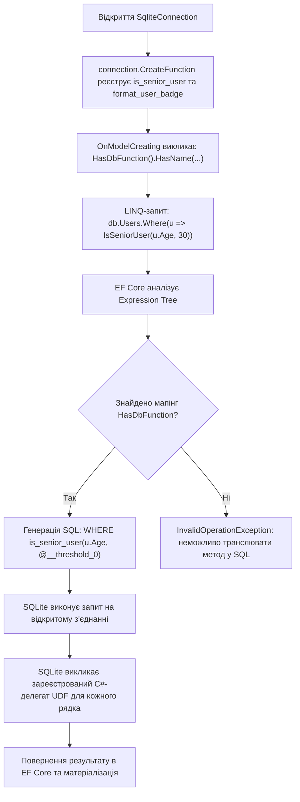

# 6.2. Збережені функції (SQLite UDF / HasDbFunction адаптація)

- **Глава:** 07. SQL в Entity Framework Core
- **Джерело Metanit:** [https://metanit.com/sharp/efcore/6.2.php](https://metanit.com/sharp/efcore/6.2.php)
- **Код прикладу:** [Lesson_6_2_StoredFunctions.cs](../../src/07_SqlAndStoredProcedures/Lesson_6_2_StoredFunctions.cs)

---

## Мета уроку

Зрозуміти, як EF Core інтегрується зі збереженими функціями бази даних:
- засвоїти класичний підхід для MS SQL Server (табличні функції `CREATE FUNCTION ... RETURNS TABLE`, виклик через `FromSqlRaw` та проєкція на метод `DbContext` через `FromExpression` і `HasDbFunction`);
- навчитися проєктувати скалярні функції БД (як вбудовані, так і користувацькі) на статичні методи C# через `modelBuilder.HasDbFunction(...).HasName(...)`;
- реалізувати еквівалент скалярних збережених функцій у SQLite за допомогою `SqliteConnection.CreateFunction` (User-Defined Functions, UDF).

---

## Детальний теоретичний матеріал

У клієнт-серверних реляційних СУБД (зокрема MS SQL Server, який розглядається в базовому уроці на Metanit) частину логіки вибірки та обчислень можна винести на бік сервера БД у вигляді **збережених функцій** (`CREATE FUNCTION`). Вони поділяються на два типи:
1. **Табличні функції (Table-Valued Functions, TVF)** — повертають набір рядків (таблицю), яку можна використовувати у секції `FROM`.
2. **Скалярні функції** — приймають параметри та повертають одне значення (`int`, `string`, `bool`, `DateTime` тощо), яке можна використовувати у `SELECT`, `WHERE` або `ORDER BY`.

EF Core підтримує роботу з функціями БД двома основними способами:
1. **Через сирий SQL** (`FromSqlRaw` / `FromSqlInterpolated`).
2. **Через проєкцію на метод C# (`HasDbFunction`)** — метод реєструється в `OnModelCreating`, після чого викликається у звичайних LINQ-запитах, а EF Core самостійно транслює цей виклик у відповідний SQL-вираз.

### 1. Класичний підхід для MS SQL Server (за матеріалами Metanit)

У MS SQL Server створюється таблична функція `GetUsersByAge`, яка повертає користувачів молодших за переданий вік `@age`:

```sql
CREATE FUNCTION [dbo].[GetUsersByAge]
(
    @age int
)
RETURNS @returntable TABLE
(
    Id int,
    CompanyId int,
    Name nvarchar(50),
    Age int
)
AS
BEGIN
    INSERT @returntable
    SELECT Id, CompanyId, Name, Age FROM Users WHERE Age < @age
    RETURN
END
```

Звернутися до такої TVF у EF Core можна двома способами:

#### Спосіб А: Виклик у `FromSqlRaw`
```csharp
SqlParameter param = new SqlParameter("@age", 30);
var users = db.Users
    .FromSqlRaw("SELECT * FROM GetUsersByAge (@age)", param)
    .ToList();
```
Тут замість імені таблиці у `FROM` вказується виклик табличної функції з параметром.

#### Спосіб Б: Проєкція на метод контексту (`FromExpression` + `HasDbFunction`)
У класі `ApplicationContext` оголошується метод екземпляра, що повертає `IQueryable<User>` і делегує побудову дерева виразів методу `DbContext.FromExpression`:

```csharp
public class ApplicationContext : DbContext
{
    public DbSet<Company> Companies { get; set; } = null!;
    public DbSet<User> Users { get; set; } = null!;

    public IQueryable<User> GetUsersByAge(int age)
        => FromExpression(() => GetUsersByAge(age));

    protected override void OnModelCreating(ModelBuilder modelBuilder)
    {
        modelBuilder.HasDbFunction(() => GetUsersByAge(default));
    }
}
```
Після реєстрації функцію можна викликати як звичайний метод C# у LINQ-запитах:
```csharp
var users = db.GetUsersByAge(30).Where(u => u.Name != null).ToList();
```

### 2. Проєкція скалярних функцій через `HasDbFunction`

Для скалярних функцій (як збережених у БД, так і вбудованих функцій СУБД, наприклад `length`, `upper`, `lower`) створюють **статичний метод-заглушку** у класі контексту або в окремому статичному класі:

```csharp
public static bool IsSeniorUser(int age, int threshold)
    => throw new NotSupportedException("Цей метод призначений лише для LINQ-запитів EF Core.");
```
Саме тіло методу ніколи не виконується в .NET-пам'яті — виняток `NotSupportedException` слугує захистом від випадкового виклику поза LINQ-виразом. У `OnModelCreating` цей метод прив'язується до імені функції в SQL через рефлексію:

```csharp
modelBuilder.HasDbFunction(
        typeof(ApplicationContext).GetMethod(nameof(IsSeniorUser), new[] { typeof(int), typeof(int) })!)
    .HasName("is_senior_user");
```
Також можна додатково налаштовувати схему (`.HasSchema("dbo")`) або спосіб трансляції параметрів.

### 3. Адаптація для SQLite: користувацькі UDF (`SqliteConnection.CreateFunction`)

SQLite — це вбудована файлова СУБД, яка **не підтримує** DDL-синтаксис `CREATE FUNCTION` у SQL, а також не має табличних функцій (TVF). Однак офіційний провайдер `Microsoft.Data.Sqlite` надає потужний механізм **User-Defined Functions (UDF)**: будь-який C#-делегат можна зареєструвати як скалярну функцію безпосередньо на об'єкті `SqliteConnection`:

```csharp
connection.CreateFunction<int, int, bool>(
    "is_senior_user",
    (age, threshold) => age >= threshold,
    isDeterministic: true);
```
Коли SQLite виконує SQL-запит із викликом `is_senior_user("u"."Age", @__threshold_0)`, рушій SQLite викликає зареєстрований C#-делегат для кожного рядка вибірки в межах того самого процесу без мережевих витрат.

---

## Діаграма / Архітектура процесу

На діаграмі нижче показано повний шлях трансляції методу C# через `HasDbFunction` у виклик SQLite UDF під час виконання LINQ-запиту:



---

## Покроковий розбір прикладів коду

У файлі [Lesson_6_2_StoredFunctions.cs](../../src/07_SqlAndStoredProcedures/Lesson_6_2_StoredFunctions.cs) продемонстровано спільну роботу `SqliteConnection.CreateFunction` і EF Core `HasDbFunction`.

### Крок 1. Підготовка файлу БД та реєстрація UDF на з'єднанні
Оскільки UDF прив'язуються до конкретного екземпляра `SqliteConnection`, перед видаленням старого файлу БД очищаються пули з'єднань (`SqliteConnection.ClearAllPools()`), щоб файл не був заблокований, після чого відкривається нове з'єднання:

```csharp
using var connection = new SqliteConnection(connectionString);
connection.Open();

connection.CreateFunction<int, int, bool>(
    "is_senior_user",
    (age, threshold) => age >= threshold,
    isDeterministic: true);

connection.CreateFunction<string, int, string>(
    "format_user_badge",
    (name, age) => $"{name} [{age} р.]",
    isDeterministic: true);
```
Це відкрите з'єднання передається в конструктор `ApplicationContext(connection)`, а в `OnConfiguring` використовується `optionsBuilder.UseSqlite(_connection)`.

### Крок 2. Оголошення C#-заглушок і конфігурація `HasDbFunction`
У `ApplicationContext` оголошені три статичні методи:
- `IsSeniorUser(int age, int threshold)` -> мапиться на UDF `is_senior_user`;
- `FormatUserBadge(string name, int age)` -> мапиться на UDF `format_user_badge`;
- `SqliteLength(string? text)` -> мапиться на **вбудовану** функцію SQLite `length`.

У `OnModelCreating` кожен із них реєструється через `modelBuilder.HasDbFunction(MethodInfo).HasName("...")`.

### Крок 3. Виклик функцій у LINQ-запиті (`HasDbFunction`)
```csharp
int threshold = 30;
var seniorBadges = db.Users
    .Where(u => ApplicationContext.IsSeniorUser(u.Age, threshold))
    .OrderBy(u => u.Age)
    .Select(u => new
    {
        Badge = ApplicationContext.FormatUserBadge(u.Name ?? "Unknown", u.Age),
        NameLength = ApplicationContext.SqliteLength(u.Name)
    })
    .ToList();
```
EF Core транслює цей LINQ-вираз у SQLite-запит приблизно такого вигляду:
```sql
SELECT format_user_badge(COALESCE("u"."Name", 'Unknown'), "u"."Age") AS "Badge",
       length("u"."Name") AS "NameLength"
FROM "Users" AS "u"
WHERE is_senior_user("u"."Age", @__threshold_0)
ORDER BY "u"."Age"
```
У результаті фільтрація (`Where`), форматування бейджа (`format_user_badge`) та підрахунок довжини імені (`length`) виконуються безпосередньо під час виконання SQL-запиту, повертаючи лише `Tom [36 р.]`, `Bob [39 р.]` та `Tomek [42 р.]`.

### Крок 4. Виклик UDF безпосередньо у `FromSqlRaw`
```csharp
var youngerUsers = db.Users
    .FromSqlRaw("SELECT * FROM Users WHERE is_senior_user(Age, {0}) = 0 ORDER BY Age", threshold)
    .ToList();
```
Зареєстрована на `SqliteConnection` функція доступна також і в ручних SQL-запитах (`FromSqlRaw` / `FromSql` / `SqlQuery<T>`). Зверніть увагу на порівняння `= 0`: у SQLite логічний тип `bool` зберігається та повертається як ціле число (`0` — `false`, `1` — `true`). Повертаються `Tomas` (22), `Kate` (25) та `Alice` (28).

---

## Особливості роботи в SQLite

| Аспект | MS SQL Server (Metanit) | SQLite (цей проєкт) |
| :--- | :--- | :--- |
| Створення функції в БД | `CREATE FUNCTION` у T-SQL (зберігається в метаданих БД) | Відсутнє в SQL DDL; реєструється в runtime через `SqliteConnection.CreateFunction` |
| Табличні функції (TVF) | Повністю підтримуються (`RETURNS TABLE` + `FromExpression`) | **Не підтримуються** (альтернатива — `FromSql*` або `VIEW`) |
| Скалярні функції | `CREATE FUNCTION ... RETURNS <type>` | `CreateFunction(...)` або вбудовані (`length`, `upper`, `lower`, `substr`, `coalesce`) |
| Булеві значення | Тип `BIT` | Цілі числа `0` (`false`) та `1` (`true`) |
| Управління з'єднанням | Достатньо рядка підключення | Потрібно передавати відкритий `SqliteConnection` в `UseSqlite(connection)` |

---

## Типові помилки, підводні камені та Best Practices

1. **Виклик методу-заглушки поза LINQ-запитом:**
   - *Помилка:* виклик `ApplicationContext.IsSeniorUser(u.Age, 30)` після `.AsEnumerable()` або `.ToList()`, або напряму в C#-коді.
   - *Наслідок:* миттєвий виняток `NotSupportedException` (або неможливість трансляції, якщо метод використовується в клієнтській проєкції з недозволеним контекстом).
   - *Best Practice:* якщо метод має бути доступний і в пам'яті, можна реалізувати в ньому реальну C#-логіку замість `throw new NotSupportedException(...)`, але чітко розуміти, де виконується код (на боці БД чи в .NET).

2. **Закриття або перестворення `SqliteConnection`:**
   - *Підводний камінь:* функції, зареєстровані через `CreateFunction`, існують **лише в межах того конкретного екземпляра `SqliteConnection`**, на якому були викликані. Якщо передати в `UseSqlite` рядок підключення замість об'єкта `connection`, EF Core відкриє нове з'єднання, де функції `is_senior_user` не буде (`SQLite Error 1: 'no such function: is_senior_user'`).
   - *Best Practice:* реєструйте UDF у централізованому місці (наприклад, через `DbConnectionInterceptor` або фабрику з'єднань DI), щоб кожне відкрите з'єднання гарантовано отримувало потрібні UDF.

3. **Блокування файлу `.db` при відкритому з'єднанні:**
   - Як показано в `Lesson_6_2_StoredFunctions.cs`, перед `File.Delete(dbPath)` обов'язково викликайте `SqliteConnection.ClearAllPools()`, інакше пул з'єднань утримуватиме файл відкритим.

4. **Прапорець `isDeterministic: true`:**
   - Якщо результат вашої UDF залежить виключно від переданих аргументів (без `DateTime.Now`, `Random` чи зовнішнього стану), завжди передавайте `isDeterministic: true` — це дозволяє планувальнику SQLite кешувати результати та ефективніше використовувати індекси.
