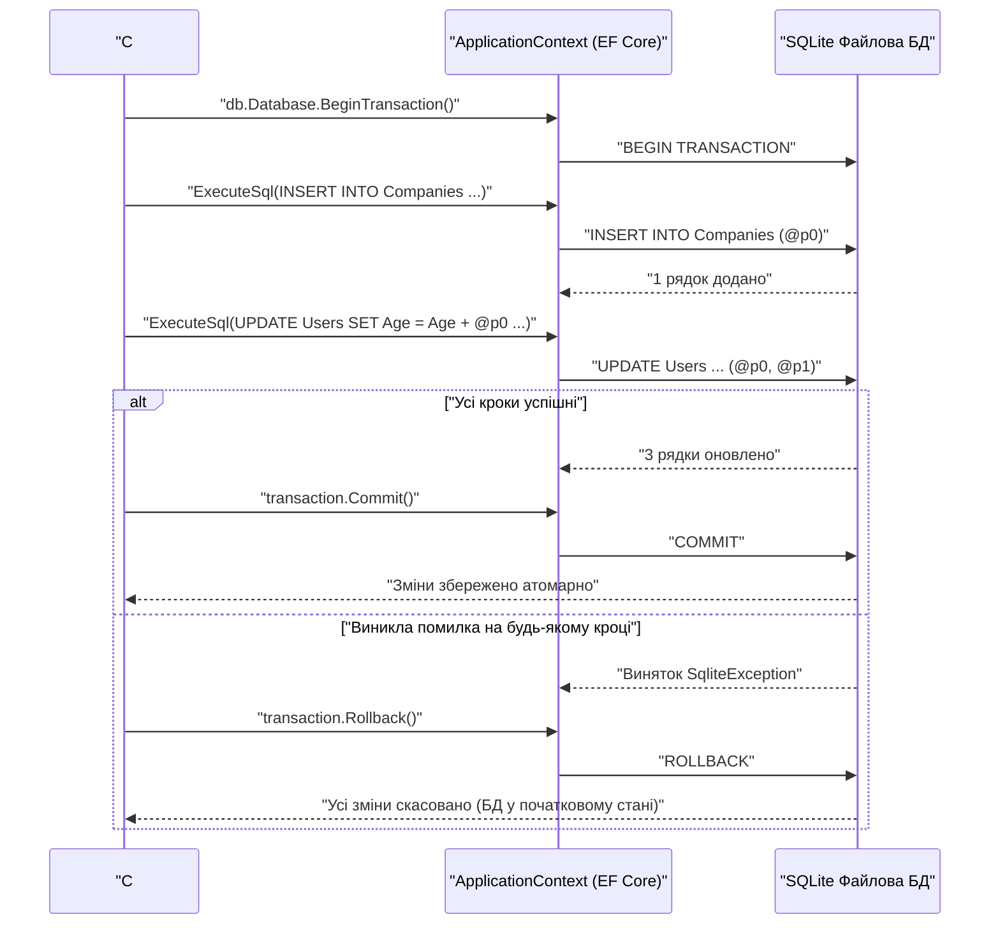

# 7.3. Збережені процедури (обмеження SQLite та параметризований SQL)

- **Глава:** 07. SQL в Entity Framework Core
- **Джерело Metanit:** [https://metanit.com/sharp/efcore/6.3.php](https://metanit.com/sharp/efcore/6.3.php)
- **Код прикладу:** [Lesson_7_03_StoredProcedures.cs](../../src/07_SqlAndStoredProcedures/Lesson_7_03_StoredProcedures.cs)
- **Запуск уроку:** `dotnet run --project src/EFCoreMastery.ConsoleApp -- 7.3`
- **Шпаргалка глави:** [Runs.md](Runs.md)

---

## Мета уроку

Зрозуміти, як EF Core працює зі збереженими процедурами:
- вивчити синтаксис створення та виклику збережених процедур у MS SQL Server із вхідними параметрами (`FromSqlRaw`) та вихідними `OUTPUT`-параметрами (`ExecuteSqlRaw` + `ParameterDirection.Output`);
- розібратися, чому вбудована СУБД SQLite принципово не підтримує збережені процедури;
- навчитися реалізовувати повний функціональний еквівалент збережених процедур у SQLite за допомогою параметризованого SQL, `Database.SqlQuery<T>` та явних транзакцій (`BeginTransaction`, `Commit`, `Rollback`).

---

## Детальний теоретичний матеріал

У клієнт-серверних СУБД (MS SQL Server, PostgreSQL, MySQL, Oracle) **збережені процедури** (`CREATE PROCEDURE`) — це заздалегідь скомпільовані сценарії на стороні сервера БД, які можуть приймати параметри, виконувати умовну логіку, цикли, кілька DML-команд у межах транзакції та повертати набори рядків або окремі значення через `OUTPUT`-параметри.

### 1. Збережені процедури в MS SQL Server (за матеріалами Metanit)

#### А. Процедура з вхідним параметром, що повертає набір сутностей
У T-SQL створюється процедура `GetUsersByCompany`:

```sql
CREATE PROCEDURE [dbo].[GetUsersByCompany]
    @name nvarchar(50)
AS
    SELECT * FROM Users
    WHERE CompanyId = (SELECT Id FROM Companies WHERE Name = @name)
GO
```

У EF Core її викликають через `DbSet<T>.FromSqlRaw`, передаючи ім'я процедури, перелік параметрів та об'єкт `SqlParameter` (з `Microsoft.Data.SqlClient`):

```csharp
SqlParameter param = new("@name", "Microsoft");
var users = db.Users
    .FromSqlRaw("GetUsersByCompany @name", param)
    .ToList();
```
> **Важливо:** при виклику процедури через `EXEC` / ім'я процедури в `FromSqlRaw` **не можна** докомпонувати LINQ-оператори (`Where`, `OrderBy`, `Include`), оскільки SQL Server не дозволяє використовувати `EXEC` всередині підзапиту `FROM (...)`. У таких випадках фільтрацію та сортування потрібно виконувати або всередині самої процедури, або після `.AsEnumerable()`.

#### Б. Процедура з вихідним параметром (`OUTPUT`)
Якщо процедура не повертає таблицю, а повинна передати окреме скалярне значення (наприклад, ім'я найстаршого користувача):

```sql
CREATE PROCEDURE [dbo].[GetUserWithMaxAge]
    @name varchar(50) OUTPUT
AS
    SELECT @name = [Name]
    FROM Users
    WHERE Age = (SELECT MAX(Age) FROM Users)
RETURN 0
```

У EF Core для виклику використовується `db.Database.ExecuteSqlRaw`, а параметр налаштовується з `Direction = ParameterDirection.Output`:

```csharp
SqlParameter param = new()
{
    ParameterName = "@userName",
    SqlDbType = System.Data.SqlDbType.VarChar,
    Direction = System.Data.ParameterDirection.Output,
    Size = 50
};
db.Database.ExecuteSqlRaw("GetUserWithMaxAge @userName OUT", param);
Console.WriteLine(param.Value);
```
Після виконання `ExecuteSqlRaw` значення автоматично записується в `param.Value`. Для рядкових `OUTPUT`-параметрів у `SqlParameter` обов'язково потрібно вказувати `Size`, інакше рядок може бути обрізаний або викличе помилку.

### 2. Чому SQLite не підтримує збережені процедури

На відміну від MS SQL Server, SQLite — це **вбудована бібліотека без серверного процесу** (`in-process`). Вона працює в тому самому адресному просторі, що й ваш C#-застосунок, і читає/пише безпосередньо у локальний файл `.db`. Через цю архітектуру в SQLite:
- **відсутній** синтаксис `CREATE PROCEDURE`, `EXEC`, `CALL`;
- **відсутні** `OUTPUT`-параметри SQL-команд;
- уся бізнес-логіка розгалужень і циклів виконується безпосередньо в коді .NET, що не створює мережевих затримок.

### 3. Альтернативи збереженим процедурам у SQLite

Будь-який сценарій, для якого в MS SQL Server пишуть збережену процедуру, у SQLite (+ EF Core) реалізується трьома чистими патернами:

| Сценарій у MS SQL Server | Еквівалент у SQLite + EF Core |
| :--- | :--- |
| Процедура вибірки з вхідним параметром (`FromSqlRaw("Proc @p", param)`) | Параметризований `FromSqlRaw` або `FromSql` / `FromSqlInterpolated` із `SELECT` |
| Процедура з `OUTPUT`-параметром (`ExecuteSqlRaw("Proc @out OUT", param)`) | `db.Database.SqlQuery<T>($"SELECT ... AS Value")` |
| Багатокрокова DML-процедура з транзакцією | Явна транзакція `db.Database.BeginTransaction()` + `ExecuteSql` / `ExecuteSqlRaw` + `Commit` / `Rollback` |

---

## Діаграма / Архітектура процесу

На діаграмі послідовності показано потік виконання атомарної багатокрокової операції в транзакції (еквівалент DML-процедури в SQLite):



---

## Покроковий розбір прикладів коду

У файлі [Lesson_7_03_StoredProcedures.cs](../../src/07_SqlAndStoredProcedures/Lesson_7_03_StoredProcedures.cs) кожен із класичних сценаріїв Metanit 6.3 адаптовано для роботи з SQLite (`lesson_6_3_stored_procedures`).

### Крок 1. Ініціалізація БД
Створюються компанії `Microsoft` та `Google`, а також 6 користувачів (`Tom` 36, `Bob` 39, `Alice` 28, `Kate` 25, `Tomas` 22, `Tomek` 42).

### Крок 2. Альтернатива `GetUsersByCompany` (вхідний параметр)
Замість виклику неіснуючої в SQLite процедури `GetUsersByCompany @name` виконується параметризований `FromSqlRaw` з об'єктом `SqliteParameter`:

```csharp
string targetCompany = "Microsoft";
SqliteParameter companyParam = new("@name", targetCompany);

var companyUsers = db.Users
    .FromSqlRaw(
        "SELECT * FROM Users WHERE CompanyId = (SELECT Id FROM Companies WHERE Name = @name)",
        companyParam)
    .ToList();
```
Повертаються працівники компанії `Microsoft`: `Tom` (36), `Alice` (28), `Tomas` (22). На відміну від `EXEC` у SQL Server, до цього запиту за потреби можна докомпонувати `.OrderBy(...)` чи `.Include(...)`.

### Крок 3. Альтернатива `OUTPUT`-параметру (`Database.SqlQuery<string>`)
Замість `GetUserWithMaxAge @userName OUT` використовується скалярний запит через EF Core 8 `SqlQuery<string>`:

```csharp
string? oldestUserName = db.Database
    .SqlQuery<string>($"""
        SELECT Name AS Value
        FROM Users
        WHERE Age = (SELECT MAX(Age) FROM Users)
        LIMIT 1
        """)
    .SingleOrDefault();
```
- Псевдонім `AS Value` обов'язковий для мапінгу в скалярний тип `string`.
- `LIMIT 1` гарантує, що навіть якщо кілька користувачів мають однаковий максимальний вік, `SingleOrDefault()` не кине виняток. У прикладі повертається `Tomek` (42 роки).

### Крок 4. Атомарна багатокрокова операція в транзакції
У клієнт-серверних БД кілька пов'язаних змін часто об'єднують у збережену процедуру. У SQLite ту саму атомарність забезпечує `BeginTransaction()`:

```csharp
using var transaction = db.Database.BeginTransaction();
try
{
    string newComp = "OpenAI";
    db.Database.ExecuteSql(
        $"INSERT INTO Companies (Name) VALUES ({newComp})");

    int ageIncrease = 1;
    int updatedCount = db.Database.ExecuteSql(
        $"UPDATE Users SET Age = Age + {ageIncrease} WHERE CompanyId = (SELECT Id FROM Companies WHERE Name = {targetCompany})");

    transaction.Commit();
}
catch
{
    transaction.Rollback();
    throw;
}
```
Обидві команди (`INSERT` та `UPDATE`) виконуються в межах однієї транзакції SQLite з автоматичною параметризацією (`ExecuteSql` приймає `FormattableString`). Якщо другий крок завершиться помилкою, `Rollback()` скасує і додавання `OpenAI`. Після `Commit()` перевірка через `db.Users.FromSql(...).AsNoTracking()` підтверджує, що вік `Tom`, `Alice` та `Tomas` збільшився на 1 рік (37, 29, 23).

---

## Особливості роботи в SQLite

- **Синтаксична помилка при `CREATE PROCEDURE` / `EXEC`:** будь-яка спроба виконати T-SQL синтаксис процедур у SQLite призведе до `SqliteException: SQLite Error 1: 'near "PROCEDURE": syntax error'`.
- **Потенційна проблема з `ChangeTracker` при повторному читанні:** у прикладі наприкінці уроку використано `.AsNoTracking()`, але якби ми читали `Users` без `AsNoTracking()` у тому самому контексті, де вони вже були завантажені на Кроці 2, то `ChangeTracker` повернув би старі об'єкти зі старим віком (`36`, `28`, `22`), незважаючи на `UPDATE` в БД!
- **Продуктивність транзакцій у SQLite:** без явної транзакції кожен `ExecuteSql` створює власну неявну транзакцію та синхронізує запис на диск (`fsync`). Об'єднання кількох операцій у `BeginTransaction()` у SQLite не лише гарантує атомарність, а й прискорює пакетні зміни в десятки разів.

---

## Типові помилки, підводні камені та Best Practices

1. **Забутий `Size` для рядкового `OUTPUT`-параметра в SQL Server:**
   - *Помилка:* створення `SqlParameter` з `Direction = ParameterDirection.Output` для `VarChar` / `NVarChar` без задання `Size`.
   - *Наслідок:* або виняток провайдера, або повернення лише 1 символу.
   - *Best Practice:* завжди задавайте `Size` (наприклад, `Size = 50` або `-1` для `MAX`).

2. **Спроба додати LINQ-композицію до збереженої процедури в SQL Server:**
   - *Помилка:* `db.Users.FromSqlRaw("GetUsersByCompany @name", param).OrderBy(u => u.Age).ToList()`.
   - *Наслідок:* помилка компіляції SQL у SQL Server (неможливо обгорнути `EXEC` у підзапит `FROM (...)`).
   - *Best Practice:* використовуйте `AsEnumerable()` перед LINQ-операторами в пам'яті або переносьте сортування/фільтрацію в саму процедуру.

3. **Забутий `Rollback()` або `using` для транзакції:**
   - *Best Practice:* завжди обгортайте `db.Database.BeginTransaction()` у `using var transaction = ...` і блок `try / catch` з явним `transaction.Rollback()` при винятку.

4. **Портабельність коду між SQLite (тести) та SQL Server (продакшен):**
   - Якщо ваш проєкт використовує SQL Server у продакшені та SQLite в інтеграційних тестах, уникайте розкиданих по контролерах викликів `EXEC ProcName` — інкапсулюйте доступ до даних у сервісах/репозиторіях або використовуйте стандартні LINQ-запити та `SqlQuery<T>`.

---
<!-- lesson-nav -->
← [7.2. Збережені функції (SQLite UDF / HasDbFunction адаптація)](7_02_StoredFunctions.md) | [Шпаргалка глави (Runs.md)](Runs.md) | [Зміст курсу (README)](../../README.md) | [8.1. Паралелізм та оптимістичне блокування (Concurrency)](../08_AdvancedTopics/8_01_Concurrency.md) →
