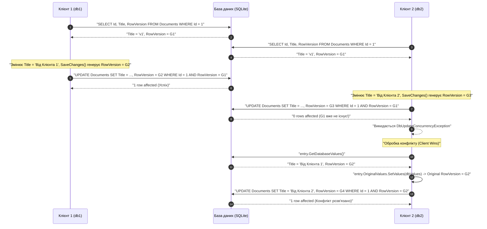

# 2.11. Паралелізм та оптимістичне блокування (Concurrency)

- **Глава:** 08. Додаткові теми
- **Джерело Metanit:** [https://metanit.com/sharp/efcore/2.11.php](https://metanit.com/sharp/efcore/2.11.php)
- **Код прикладу:** [Lesson_2_11_Concurrency.cs](../../src/08_AdvancedTopics/Lesson_2_11_Concurrency.cs)

---

## Мета уроку

Навчитися захищати дані від втрати оновлень (*lost update*) у багатокористувацькому середовищі за допомогою механізму **оптимістичного блокування (Optimistic Concurrency)** в Entity Framework Core, налаштовувати токени паралелізму через атрибут `[ConcurrencyCheck]`, Fluent API `IsConcurrencyToken()`, а також `[Timestamp]` / `IsRowVersion()`, і грамотно обробляти виняток `DbUpdateConcurrencyException`.

---

## Детальний теоретичний матеріал

### 1. Проблема паралелізму та втраченого оновлення

Коли кілька користувачів, мікросервісів або потоків одночасно мають доступ до одного й того самого рядка в таблиці бази даних, виникає класична проблема паралельного доступу (*Concurrency Conflict*):

1. Користувач A завантажує запис (`Id = 1, Name = "Tom"`).
2. Користувач B незалежно завантажує той самий запис (`Id = 1, Name = "Tom"`).
3. Користувач A змінює `Name = "Bob"` і зберігає зміни в БД.
4. Користувач B змінює `Name = "Alice"` і теж викликає `SaveChanges()`.

Без механізму контролю паралелізму EF Core генерує стандартний запит `UPDATE "Users" SET "Name" = 'Alice' WHERE "Id" = 1;`. У результаті зміни Користувача A безслідно перезаписуються (*Lost Update*), хоча Користувач B навіть не знав про них.

### 2. Оптимістичний vs песимістичний паралелізм

| Характеристика | Песимістичний паралелізм | Оптимістичний паралелізм (EF Core) |
| :--- | :--- | :--- |
| **Принцип роботи** | Блокує рядок у БД під час читання (`SELECT ... FOR UPDATE`), інші чекають. | Не блокує рядок під час читання; перевіряє конфлікт лише під час `SaveChanges()`. |
| **Продуктивність** | Знижує пропускну здатність, можливі взаємні блокування (*deadlocks*). | Висока пропускна здатність, ідеально для веб-застосунків та API. |
| **Підтримка в EF Core** | Тільки через ручні транзакції та сирий SQL. | Вбудована підтримка через **токени паралелізму (Concurrency Tokens)**. |
| **Реакція на конфлікт** | Другий користувач чекає зняття блокування. | Викидається `DbUpdateConcurrencyException`, який обробляє код. |

### 3. Токени паралелізму (Concurrency Tokens)

**Токен паралелізму** — це властивість сутності, оригінальне значення якої EF Core запам'ятовує у `ChangeTracker` (`OriginalValues`) під час завантаження об'єкта з БД і включає в умову `WHERE` при виконанні `UPDATE` або `DELETE`.

Якщо рядок за цей час змінив інший клієнт, умова `WHERE` не знайде жодного рядка (`0 rows affected`). EF Core фіксує розбіжність між очікуваною кількістю змінених рядків (`1`) і фактичною (`0`), після чого викидає `DbUpdateConcurrencyException`.

#### Спосіб 1: Атрибут `[ConcurrencyCheck]`

Атрибут із простору імен `System.ComponentModel.DataAnnotations` дозволяє позначити будь-яку властивість моделі як токен паралелізму:

```csharp
using System.ComponentModel.DataAnnotations;

public class User
{
    public int Id { get; set; }

    [ConcurrencyCheck]
    public string? Name { get; set; }
}
```

При оновленні `Name` з `"Tom"` на `"Bob"` EF Core згенерує SQL із перевіркою старого значення `Name`:

```sql
UPDATE "Users"
SET "Name" = @p0
WHERE "Id" = @p1 AND "Name" = @p2;
SELECT changes();
```

#### Спосіб 2: Fluent API `IsConcurrencyToken()`

Якщо ви не хочете змішувати доменну модель із атрибутами Data Annotations, токен паралелізму налаштовується у `OnModelCreating`:

```csharp
modelBuilder.Entity<User>()
    .Property(u => u.Version)
    .IsConcurrencyToken();
```

Функціонально `IsConcurrencyToken()` працює абсолютно ідентично до `[ConcurrencyCheck]`. На одній сутності може бути налаштовано як один, так і кілька токенів паралелізму (наприклад, і `Name`, і `Version`).

#### Спосіб 3: `[Timestamp]` та `IsRowVersion()` (MS SQL Server)

Замість перевірки бізнес-полів (як-от `Name`) у промислових системах часто використовують окремий технічний стовпець версії рядка:

```csharp
public class User
{
    public int Id { get; set; }
    public string? Name { get; set; }

    [Timestamp]
    public byte[]? Timestamp { get; set; }
}

// Або через Fluent API:
modelBuilder.Entity<User>()
    .Property(u => u.Timestamp)
    .IsRowVersion();
```

- У **MS SQL Server** це створює стовпець типу `rowversion` (раніше `timestamp`), значення якого **автоматично** оновлюється сервером БД при кожному `INSERT` та `UPDATE`.
- Перевага `rowversion`: навіть якщо користувач змінив лише `Age`, а `Name` не чіпав, версія всього рядка все одно зміниться, і конфлікт буде виявлено.

### 4. Розв'язання конфлікту `DbUpdateConcurrencyException`

Коли виникає `DbUpdateConcurrencyException`, у блоці `catch` ми можемо отримати `EntityEntry` конфліктної сутності через `ex.Entries.Single()` та порівняти три набори значень:

- **`entry.OriginalValues`** — значення, які були в БД на момент завантаження сутності цим контекстом.
- **`entry.CurrentValues`** — нові значення, які поточний клієнт намагався зберегти.
- **`entry.GetDatabaseValues()`** — актуальні значення, які зараз фізично лежать у БД (або `null`, якщо рядок уже видалили).

| Стратегія | Суть | Як реалізувати в EF Core |
| :--- | :--- | :--- |
| **Database Wins** (Перемагає БД) | Відхиляємо локальні зміни клієнта й приймаємо актуальний стан із БД. | `entry.OriginalValues.SetValues(dbValues);` та `entry.CurrentValues.SetValues(dbValues);` |
| **Client Wins** (Перемагає клієнт) | Перезаписуємо БД змінами поточного клієнта поверх чужих змін. | `entry.OriginalValues.SetValues(dbValues);` (щоб оновився токен в `OriginalValues`), потім повторний `db.SaveChanges()`. |
| **Custom Merge** (Користувацьке злиття) | Порівнюємо поля вручну або показуємо форму користувачу, формуємо гібридний об'єкт. | Оновлюємо потрібні поля в `entry.CurrentValues`, ставимо `entry.OriginalValues.SetValues(dbValues)` і викликаємо `SaveChanges()`. |

---

## Діаграма / Архітектура процесу

Діаграма послідовності демонструє виникнення конфлікту оптимістичного паралелізму між двома клієнтами та його розв'язання:



---

## Покроковий розбір прикладів коду

У файлі [Lesson_2_11_Concurrency.cs](../../src/08_AdvancedTopics/Lesson_2_11_Concurrency.cs) розглянуто два практичні сценарії:

### Сценарій 1: `[ConcurrencyCheck]` на властивості `Name` + `IsConcurrencyToken()` на `Version`

1. **Модель `User`:**
   - Властивість `Name` позначена атрибутом `[ConcurrencyCheck]`.
   - Властивість `Version` налаштована у `OnModelCreating` через `.Property(u => u.Version).IsConcurrencyToken()`.
   - Початковий запис у БД: `Id = 1, Name = "Tom", Version = 1`.
2. **Паралельне завантаження:**
   - Відкриваються два незалежні контексти `db1` і `db2`, що імітують двох користувачів.
   - Обидва завантажують `User` з `Id == 1`.
3. **Успішне збереження першого клієнта:**
   - `db1` змінює `Name = "Bob"` і `Version++` (`2`), викликає `db1.SaveChanges()`.
   - SQLite виконує:
     ```sql
     UPDATE "Users"
     SET "Name" = 'Bob', "Version" = 2
     WHERE "Id" = 1 AND "Name" = 'Tom' AND "Version" = 1;
     SELECT changes(); -- повертає 1
     ```
4. **Конфлікт другого клієнта та стратегія `Database Wins`:**
   - `db2` намагається зберегти `Name = "Alice"` і `Version = 2`, але в його `OriginalValues` досі лежать `Name = "Tom"` і `Version = 1`.
   - Запит повертає `0` змінених рядків — виникає `DbUpdateConcurrencyException`.
   - У блоці `catch` викликається `entry.GetDatabaseValues()`, який повертає актуальні значення з БД (`"Bob"`, `Version = 2`).
   - Далі застосовується **Database Wins**: оновлюються і `OriginalValues`, і `CurrentValues`, тобто локальні зміни Клієнта 2 скасовуються на користь актуального стану БД.

### Сценарій 2: Аналог `rowversion` у SQLite (`Guid RowVersion` + `SaveChanges()`)

1. **Модель `Document`:** має властивість `public Guid RowVersion { get; set; }`, налаштовану через `.IsConcurrencyToken()`.
2. **Перевизначення `SaveChanges()` у `ConcurrencyContext`:**
   - Перед викликом `base.SaveChanges()` контекст перебирає `ChangeTracker.Entries<Document>()` зі станом `Added` або `Modified` і присвоює `entry.Entity.RowVersion = Guid.NewGuid()`.
   - Таким чином сам застосунок гарантує зміну токена версії при будь-якому оновленні документа.
3. **Конфлікт та стратегія `Client Wins`:**
   - `db1` зберігає `"Специфікація v2 (від Клієнта 1)"`, `RowVersion` змінюється з `1111...` на новий `Guid`.
   - `db2` намагається зберегти `"Специфікація v2 (від Клієнта 2)"` зі старим `OriginalValues["RowVersion"] == 1111...` і отримує `DbUpdateConcurrencyException`.
   - У `catch` отримуємо `dbValues = entry.GetDatabaseValues()` і викликаємо **лише** `entry.OriginalValues.SetValues(dbValues)`. Це оновлює оригінальний `RowVersion` на актуальний з БД, але залишає `CurrentValues["Title"]` клієнта 2 незмінним.
   - Повторний виклик `db2.SaveChanges()` генерує ще один новий `RowVersion`, проходить перевірку `WHERE "RowVersion" = @actualDbGuid` і успішно перезаписує документ.

---

## Особливості роботи в SQLite

У статті на Metanit для механізму версіонування рядків наведено приклад із `[Timestamp]` та `IsRowVersion()` для **MS SQL Server**:

```csharp
[Timestamp]
public byte[]? Timestamp { get; set; }
```

| Аспект | MS SQL Server | SQLite |
| :--- | :--- | :--- |
| **Тип даних** | Вбудований тип `rowversion` (`timestamp`), 8-байтний лічильник. | Немає вбудованого автогенерованого `rowversion`. |
| **Поведінка `[Timestamp]` / `IsRowVersion()`** | Сервер БД **автоматично** генерує нове значення при `INSERT` і `UPDATE`. | **Не працює автоматично:** стовпець залишається `NULL` або не змінюється при оновленні, тому конфлікти не відловлюються. |
| **Рекомендоване рішення** | Використовувати `[Timestamp]` або `.IsRowVersion()`. | Використовувати `Guid` або `int` із `.IsConcurrencyToken()` та оновлювати його в `SaveChanges()` / `SaveChangesInterceptor`, або створити SQLite-тригер `AFTER UPDATE`. |

---

## Типові помилки, підводні камені та Best Practices

- **Забуте оновлення токена в SQLite:** якщо ви налаштували `.IsConcurrencyToken()` для `int Version` або `Guid RowVersion`, але не змінюєте його значення в коді (або тригером) перед збереженням, значення в БД залишиться незмінним і паралельні оновлення не викличуть `DbUpdateConcurrencyException`.
- **`GetDatabaseValues()` може повернути `null`:** це трапляється, якщо інший користувач вже **видалив** рядок із БД, поки ви його редагували. Завжди перевіряйте `if (databaseValues is not null)` перед викликом `SetValues(...)`.
- **Повторний конфлікт при `Client Wins`:** між викликом `GetDatabaseValues()` і повторним `SaveChanges()` третій користувач може встигнути знову змінити рядок. У продакшені варто обгортати повторне збереження у цикл з обмеженою кількістю спроб (наприклад, `maxRetries = 3`).
- **Використання з `AsNoTracking()` та веб-API (Disconnected Entities):** у веб-застосунках токен паралелізму (`RowVersion` у вигляді `string` чи `Guid`) потрібно передавати клієнту (наприклад, у прихованому полі форми або заголовку `ETag`), а при `PUT`/`PATCH` встановлювати `db.Entry(entity).Property(e => e.RowVersion).OriginalValue = dto.RowVersion;` перед `SaveChanges()`.
