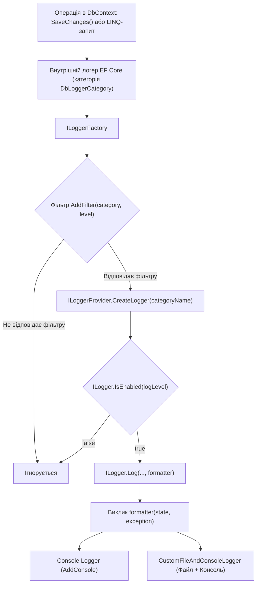

# 2.12. Провайдери логування (ILoggerFactory, Console Logger)

- **Глава:** 08. Додаткові теми
- **Джерело Metanit:** [https://metanit.com/sharp/efcore/2.12.php](https://metanit.com/sharp/efcore/2.12.php)
- **Код прикладу:** [Lesson_2_12_LoggingProviders.cs](../../src/08_AdvancedTopics/Lesson_2_12_LoggingProviders.cs)
- **Запуск уроку:** `dotnet run --project src/EFCoreMastery.ConsoleApp -- 2.12`
- **Шпаргалка глави:** [Runs.md](Runs.md)

---

## Мета уроку

Навчитися підключати та налаштовувати провайдери логування в Entity Framework Core: створювати власні провайдери через інтерфейси `ILoggerProvider` та `ILogger`, підключати їх локально до конкретного контексту або глобально через `ILoggerFactory`, фільтрувати події за категоріями `DbLoggerCategory` і рівнями `LogLevel`, а також використовувати стандартний консольний логер із пакета `Microsoft.Extensions.Logging.Console`.

---

## Детальний теоретичний матеріал

### 1. Навіщо потрібні провайдери логування, якщо є `LogTo()`?

Простий метод `optionsBuilder.LogTo(Console.WriteLine)` зручний для швидкого налагодження, але у реальних застосунках використовується стандартна абстракція логування .NET — **`Microsoft.Extensions.Logging`**. Вона дозволяє:
- централізовано керувати логами всього застосунку (ASP.NET Core, Worker Services, EF Core);
- одночасно писати логи у кілька приймачів (консоль, файл, Serilog, Seq, Application Insights);
- гнучко фільтрувати повідомлення за категоріями (`DbLoggerCategory`) та рівнями серйозності (`LogLevel`).

### 2. Архітектура `ILoggerProvider` та `ILogger`

Щоб створити власний провайдер логування, необхідно реалізувати два інтерфейси з простору імен `Microsoft.Extensions.Logging`:

1. **`ILoggerProvider`** (наслідує `IDisposable`):
   - `ILogger CreateLogger(string categoryName)` — фабричний метод, який створює або повертає екземпляр `ILogger` для певної категорії (наприклад, `Microsoft.EntityFrameworkCore.Database.Command`).
   - `void Dispose()` — звільняє ресурси провайдера (закриває файлові потоки, мережеві з'єднання тощо).

2. **`ILogger`**:
   - `IDisposable? BeginScope<TState>(TState state)` — створює область видимості (*scope*) для групування логів однієї операції. Якщо області не потрібні, можна повертати `null` або `this` (якщо клас реалізує `IDisposable`).
   - `bool IsEnabled(LogLevel logLevel)` — швидка перевірка, чи повинен логер обробляти повідомлення заданого рівня. Якщо повертає `false`, EF Core навіть не формуватиме рядок повідомлення (економія пам'яті та CPU).
   - `void Log<TState>(LogLevel logLevel, EventId eventId, TState state, Exception? exception, Func<TState, Exception?, string> formatter)` — основний метод запису логу. Саме делегат `formatter(state, exception)` перетворює структурований стан події на читабельний текст.

### 3. Способи підключення провайдерів до `DbContext`

| Спосіб | Код підключення | Область дії та коли використовувати |
| :--- | :--- | :--- |
| **Локально на екземпляр** | `db.GetService<ILoggerFactory>().AddProvider(new MyProvider());` | Діє лише для конкретного екземпляра `DbContext` (потрібен `using Microsoft.EntityFrameworkCore.Infrastructure;`). Зручно для точкового діагностування. |
| **Глобально через `UseLoggerFactory`** | `optionsBuilder.UseLoggerFactory(MyLoggerFactory);` | Стандартний підхід для консольних програм: одна `static readonly ILoggerFactory` на весь тип контексту. |
| **Вбудований Console Logger** | `builder.AddConsole()` (пакет `Microsoft.Extensions.Logging.Console`) | Коли потрібен структурований кольоровий вивід у консоль без написання власного `ILoggerProvider`. |
| **Через DI (ASP.NET Core)** | Автоматично через `AddDbContext<AppContext>(...)` | У веб-застосунках EF Core автоматично бере `ILoggerFactory` з DI-контейнера. |

### 4. Фільтрація логів за категоріями та `LogLevel`

Без фільтрації EF Core логує десятки технічних подій: ініціалізацію моделі, компіляцію запитів, відкриття/закриття з'єднань, зміни в `ChangeTracker`. Щоб бачити лише потрібну інформацію (наприклад, SQL-запити), у `LoggerFactory.Create` використовують `AddFilter`:

```csharp
public static readonly ILoggerFactory MyLoggerFactory = LoggerFactory.Create(builder =>
{
    builder
        .AddFilter((category, level) =>
            category == DbLoggerCategory.Database.Command.Name
            && level == LogLevel.Information)
        .AddConsole();
});
```

#### Основні категорії `DbLoggerCategory`

| Категорія | Що логує |
| :--- | :--- |
| `DbLoggerCategory.Database.Command.Name` | Згенеровані SQL-команди (`SELECT`, `INSERT`, `UPDATE`, `DELETE`), їхні параметри та час виконання. |
| `DbLoggerCategory.Database.Connection.Name` | Відкриття та закриття з'єднання з БД. |
| `DbLoggerCategory.Database.Transaction.Name` | Початок, підтвердження (`Commit`) та відкат (`Rollback`) транзакцій. |
| `DbLoggerCategory.Query.Name` | Побудова, компіляція та виконання LINQ-запитів. |
| `DbLoggerCategory.Update.Name` | Події `SaveChanges()`, виявлення змін та обробка пакетів команд. |
| `DbLoggerCategory.ChangeTracking.Name` | Відстеження станів сутностей у `ChangeTracker`. |

#### Рівні логування `LogLevel` (від найдетальнішого до критичного)

`Trace` → `Debug` → `Information` → `Warning` → `Error` → `Critical` → `None`.
SQL-команди за замовчуванням логуються на рівні **`LogLevel.Information`**, а помилки виконання SQL — на рівні **`LogLevel.Error`**.

---

## Діаграма / Архітектура процесу

Блок-схема конвеєра логування від операції в `DbContext` до запису у файл або консоль:



---

## Покроковий розбір прикладів коду

У файлі [Lesson_2_12_LoggingProviders.cs](../../src/08_AdvancedTopics/Lesson_2_12_LoggingProviders.cs) реалізовано три способи роботи з провайдерами логування:

1. **Власний провайдер `CustomFileAndConsoleLoggerProvider`:**
   - Приймає шлях до файлу `logFilePath` і прапорець `filterSqlOnly`.
   - Метод `CreateLogger(string categoryName)` повертає вкладений клас `CustomLogger`, який запам'ятовує `categoryName`.
   - У `IsEnabled(LogLevel logLevel)` відсікає все нижче `LogLevel.Information`.
   - У `Log<TState>(...)` викликає `formatter(state, exception)`, дописує рядок у файл `lesson_2_12_efcore.log` через `File.AppendAllText`, а в консоль виводить повідомлення сірим кольором.
2. **Секція 1 — Локальне підключення через `GetService<ILoggerFactory>()`:**
   - Створюється контекст `LoggingContext(connStr)` без зовнішньої фабрики.
   - Через `db.GetService<ILoggerFactory>().AddProvider(...)` додається `CustomFileAndConsoleLoggerProvider(..., filterSqlOnly: false)`.
   - Під час `db.SaveChanges()` та `db.Users.ToList()` у лог потрапляють **усі** події рівня `Information` і вище (ініціалізація контексту, відкриття з'єднання, SQLite-запити `INSERT INTO "Users" ... RETURNING "Id";` та `SELECT "u"."Id", "u"."Age", "u"."Name" FROM "Users" AS "u"`).
3. **Секція 2 — Глобальна фабрика з фільтром `DbLoggerCategory.Database.Command.Name`:**
   - Створюється `LoggerFactory.Create(...)` із фільтром: пропускати лише події категорії `DbLoggerCategory.Database.Command.Name` з рівнем `LogLevel.Information`.
   - Фабрика передається у `LoggingContext`, де в `OnConfiguring` викликається `optionsBuilder.UseLoggerFactory(_loggerFactory)`.
   - Тепер при виконанні `db.Users.Where(u => u.Age >= 25).ToList()` у лог потрапляє виключно згенерований SQL-запит без зайвого шуму.
4. **Секція 3 — Вбудований Console Logger (`builder.AddConsole()`):**
   - Використовується стандартний провайдер із пакета `Microsoft.Extensions.Logging.Console`.
   - Скорочений перевантажений фільтр `.AddFilter(DbLoggerCategory.Database.Command.Name, LogLevel.Information)` дозволяє бачити у консолі кольорово відформатовані SQL-команди (наприклад, `SELECT COUNT(*) FROM "Users" AS "u"`).

---

## Особливості роботи в SQLite

Механізм `ILoggerFactory` та провайдери логування є **повністю незалежними від провайдера бази даних**.
- У SQLite, як і в MS SQL Server чи PostgreSQL, категорія `DbLoggerCategory.Database.Command` фіксує точний SQL-діалект провайдера (подвійні лапки для ідентифікаторів `"Users"`, `RETURNING "Id"`, `INTEGER` тощо).
- У SQLite параметри команд у логах позначаються як `@p0`, `@p1`, але їхні реальні значення за замовчуванням приховані (`?`).

---

## Типові помилки, підводні камені та Best Practices

- **НІКОЛИ не створюйте `LoggerFactory` всередині `OnConfiguring`!** Якщо викликати `LoggerFactory.Create(...)` при кожному створенні екземпляра `DbContext`, EF Core вважатиме, що конфігурація змінилася, і щоразу будуватиме новий внутрішній сервіс-провайдер. Це призводить до стрімкого витоку пам'яті та попередження `ManyServiceProvidersCreatedWarning`. Завжди оголошуйте `ILoggerFactory` як `static readonly` поле або передавайте через DI.
- **Приховування чутливих даних:** за замовчуванням EF Core не виводить у логи значення SQL-параметрів (паролі, персональні дані). Щоб бачити параметри під час локального налагодження, потрібно явно додати `.EnableSensitiveDataLogging()` у `OnConfiguring` (але вимикати в Production!).
- **NuGet-пакет для `AddConsole()`:** метод розширення `AddConsole()` не входить до базового `Microsoft.Extensions.Logging` — необхідно встановити пакет `Microsoft.Extensions.Logging.Console`.
- **Потокобезпечність власного провайдера:** метод `ILogger.Log` може викликатися одночасно з різних потоків. У реальних проєктах для запису у файл слід використовувати `lock` або асинхронну чергу замість прямого `File.AppendAllText`.

---
<!-- lesson-nav -->
← [2.11. Паралелізм та оптимістичне блокування (Concurrency)](2_11_Concurrency.md) | [Шпаргалка глави (Runs.md)](Runs.md) | [Зміст курсу (README)](../../README.md) | [8.1. Скомпільовані запити (EF.CompileQuery / CompileAsyncQuery)](8_1_CompiledQueries.md) →
