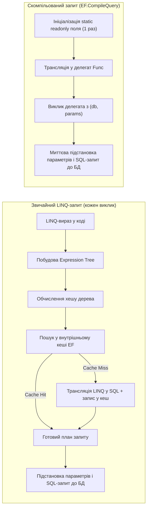

# 8.1. Скомпільовані запити (EF.CompileQuery / CompileAsyncQuery)

- **Глава:** 08. Додаткові теми
- **Джерело Metanit:** [https://metanit.com/sharp/efcore/8.1.php](https://metanit.com/sharp/efcore/8.1.php)
- **Код прикладу:** [Lesson_8_1_CompiledQueries.cs](../../src/08_AdvancedTopics/Lesson_8_1_CompiledQueries.cs)
- **Запуск уроку:** `dotnet run --project src/EFCoreMastery.ConsoleApp -- 8.1`
- **Шпаргалка глави:** [Runs.md](Runs.md)

---

## Мета уроку

Зрозуміти внутрішній життєвий цикл трансляції та кешування LINQ-запитів у Entity Framework Core і навчитися прискорювати високочастотні запити за допомогою явної компіляції через `EF.CompileQuery` та `EF.CompileAsyncQuery`.

---

## Детальний теоретичний матеріал

### 1. Як працює автоматичне кешування запитів в EF Core

EF Core не перетворює LINQ у SQL «з нуля» при кожному виклику. За замовчуванням працює автоматичний кеш запитів:
1. Код будує дерево виразів (*Expression Tree*) для вашого LINQ-запиту.
2. EF Core обчислює структурний хеш цього дерева виразів.
3. Шукає готовий план трансляції у внутрішньому кеші (`IMemoryCache`).
4. Якщо план знайдено (cache hit) — бере скомпільований делегат із кешу; якщо ні (cache miss) — виконує повну трансляцію в SQL і зберігає в кеш.

Для більшості бізнес-застосунків цього достатньо. Проте на «гарячих» ділянках коду (*hot paths*), де один і той самий запит виконується тисячі разів за секунду, кроки **побудови дерева виразів**, **обчислення хешу** та **пошуку в кеші** створюють відчутне навантаження на CPU і збирач сміття (GC).

### 2. Що роблять `EF.CompileQuery` та `EF.CompileAsyncQuery`

Явна компіляція дозволяє перенести побудову дерева виразів та трансляцію в SQL на етап ініціалізації (зазвичай у `static readonly` поле). У результаті ви отримуєте готовий строго типізований делегат `Func<TContext, ..., TResult>`, який:
- пропускає побудову дерева виразів при виклику;
- пропускає обчислення хешу та пошук у кеші;
- одразу підставляє передані параметри в уже готовий план виконання SQL.

За даними команди EF Core, скомпільовані запити можуть зменшити накладні витрати на CPU в EF Core приблизно на 10–15% для простих запитів (залежно від складності моделі).

### 3. Сигнатури та варіанти використання

Перший параметр лямбда-виразу, що передається в `EF.CompileQuery` або `EF.CompileAsyncQuery`, **завжди** є типом вашого `DbContext`. Наступні параметри (від 0 до 15) — це параметри фільтрації/сортування.

| Метод | Повертаємий тип делегата | Типові сценарії |
| :--- | :--- | :--- |
| `EF.CompileQuery` (скаляр / один об'єкт) | `Func<TContext, T1, ..., TEntity?>` | `FirstOrDefault`, `SingleOrDefault`, `Count`, `Any`, `Sum` тощо. |
| `EF.CompileQuery` (колекція) | `Func<TContext, T1, ..., IEnumerable<TEntity>>` | Запити з `Where`, `OrderBy`, `Select`, `Include` **без** `ToList()` всередині лямбди. |
| `EF.CompileAsyncQuery` (один об'єкт) | `Func<TContext, T1, ..., Task<TEntity?>>` | Асинхронне отримання одного об'єкта. Всередині лямбди пишеться синхронний `FirstOrDefault(...)`, а EF перетворює його на `Task<T?>`. |
| `EF.CompileAsyncQuery` (потік результатів) | `Func<TContext, T1, ..., IAsyncEnumerable<TEntity>>` | Потокове асинхронне читання колекції через `await foreach`. |

> [!IMPORTANT]
> У `EF.CompileAsyncQuery` для одиночних елементів або агрегатів всередині лямбди використовуйте **синхронні** методи (`FirstOrDefault`, `SingleOrDefault`, `Count`), а не `FirstOrDefaultAsync`! Сам метод `CompileAsyncQuery` автоматично обгорне виконання в асинхронний `Task<T>` або `IAsyncEnumerable<T>`.

---

## Діаграма / Архітектура процесу

Порівняння конвеєра виконання звичайного LINQ-запиту та явно скомпільованого запиту:



---

## Покроковий розбір прикладів коду

У файлі [Lesson_8_1_CompiledQueries.cs](../../src/08_AdvancedTopics/Lesson_8_1_CompiledQueries.cs) оголошено чотири `static readonly` делегати та міні-бенчмарк:

1. **`UserByIdQuery` (`EF.CompileQuery`, один об'єкт):**
   ```csharp
   private static readonly Func<CompiledQueriesContext, int, User?> UserByIdQuery =
       EF.CompileQuery((CompiledQueriesContext db, int id) =>
           db.Users.Include(u => u.Company).FirstOrDefault(u => u.Id == id));
   ```
   Приймає `(CompiledQueriesContext db, int id)`, повертає `User?` та генерує SQLite-запит із `LEFT JOIN` і `LIMIT 1`:
   ```sql
   SELECT "u"."Id", "u"."Age", "u"."CompanyId", "u"."Name", "c"."Id", "c"."Name"
   FROM "Users" AS "u"
   LEFT JOIN "Companies" AS "c" ON "u"."CompanyId" = "c"."Id"
   WHERE "u"."Id" = @__id_0
   LIMIT 1
   ```

2. **`UsersByNameAndAgeQuery` (`EF.CompileQuery`, колекція):**
   ```csharp
   private static readonly Func<CompiledQueriesContext, string, int, IEnumerable<User>> UsersByNameAndAgeQuery =
       EF.CompileQuery((CompiledQueriesContext db, string namePattern, int minAge) =>
           db.Users.Where(u => EF.Functions.Like(u.Name!, namePattern) && u.Age > minAge));
   ```
   - Використовує `EF.Functions.Like(u.Name!, namePattern)` для пошуку за шаблоном `"%Tom%"` (знайде `"Tom"` і `"Tomek"`, чий вік `> 30`; `"Tomas"` з віком `30` буде відфільтрований).
   - Виклик `.ToList()` відбувається вже **після** виклику делегата: `UsersByNameAndAgeQuery(db, "%Tom%", 30).ToList()`.

3. **`UserByIdAsyncQuery` (`EF.CompileAsyncQuery`, `Task<User?>`):**
   ```csharp
   private static readonly Func<CompiledQueriesContext, int, Task<User?>> UserByIdAsyncQuery =
       EF.CompileAsyncQuery((CompiledQueriesContext db, int id) =>
           db.Users.Include(u => u.Company).FirstOrDefault(u => u.Id == id));

   var user = await UserByIdAsyncQuery(db, 2);
   ```
   Всередині лямбди викликається синхронний `.FirstOrDefault(...)`, а сам делегат повертає `Task<User?>`.

4. **`UsersByCompanyAsyncQuery` (`EF.CompileAsyncQuery`, `IAsyncEnumerable<User>`):**
   ```csharp
   private static readonly Func<CompiledQueriesContext, string, IAsyncEnumerable<User>> UsersByCompanyAsyncQuery =
       EF.CompileAsyncQuery((CompiledQueriesContext db, string companyName) =>
           db.Users
               .Include(u => u.Company)
               .Where(u => u.Company != null && u.Company.Name == companyName)
               .OrderBy(u => u.Name));

   await foreach (var u in UsersByCompanyAsyncQuery(db, "Microsoft"))
   {
       Console.WriteLine($"{u.Name} ({u.Age})");
   }
   ```
   Повертає потік користувачів компанії `"Microsoft"`, що читається без проміжної матеріалізації всього списку.

5. **Бенчмарк (200 ітерацій):**
   - Спочатку виконується «прогрів» (один звичайний та один скомпільований запит), щоб виключити час першої компіляції та відкриття з'єднання.
   - Потім у циклі по 200 разів вимірюється час через `Stopwatch`.

---

## Особливості роботи в SQLite

- Скомпільовані запити працюють у SQLite **ідентично** до MS SQL Server, PostgreSQL чи MySQL — сам механізм працює на рівні EF Core до відправки SQL у драйвер БД.
- Функція `EF.Functions.Like(u.Name!, namePattern)` коректно транслюється у стандартний SQLite-оператор `LIKE`.
- **Чому в консольному тесті з SQLite різниця в часі мінімальна?** При роботі з локальним файлом SQLite основний час (90%+) витрачається на файловий I/O та роботу самого рушія SQLite, а не на побудову дерева виразів у C#. Справжній виграш від `EF.CompileQuery` відчутний у високонавантажених серверних застосунках (високий RPS, багато ядер CPU), де знижується навантаження на процесор і зменшується кількість алокацій пам'яті.

---

## Типові помилки, підводні камені та Best Practices

- **Помилка: оголошення `EF.CompileQuery(...)` всередині методу.** Якщо створювати делегат у локальній змінній методу, а не у `static readonly` полі, компіляція відбуватиметься при кожному виклику методу — це буде **повільніше**, ніж звичайний LINQ!
- **Помилка: виклик `.ToList()` всередині лямбди `CompileQuery`.** Для запитів, що повертають колекцію, лямбда має повертати `IQueryable<T>` (без `ToList()`). Якщо викликати `ToList()` всередині, EF Core або видасть помилку, або не зможе оптимізувати потокове читання.
- **Захоплення зовнішніх змінних (Closures):** не використовуйте всередині скомпільованої лямбди локальні змінні чи поля класу напряму — усі динамічні значення мають передаватися як параметри делегата.
- **Обмеження функціоналу:** деякі динамічні конструкції (наприклад, умовна побудова `Where` через `if` залежно від параметрів) не підтримуються в одному скомпільованому запиті — для різних комбінацій фільтрів доведеться створити окремі делегати або використовувати звичайний LINQ.

---
<!-- lesson-nav -->
← [2.12. Провайдери логування (ILoggerFactory, Console Logger)](2_12_LoggingProviders.md) | [Шпаргалка глави (Runs.md)](Runs.md) | [Зміст курсу (README)](../../README.md) | [8.2. Проєкція запитів на представлення (Views / ToView)](8_2_DatabaseViews.md) →
