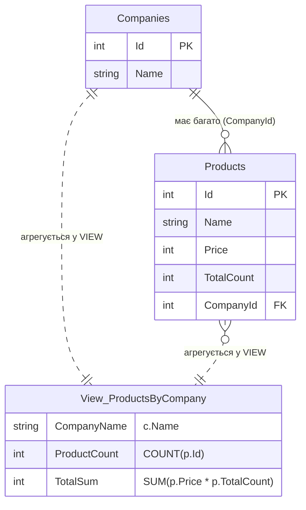

# 8.2. Проєкція запитів на представлення (Views / ToView)

- **Глава:** 08. Додаткові теми
- **Джерело Metanit:** [https://metanit.com/sharp/efcore/8.2.php](https://metanit.com/sharp/efcore/8.2.php)
- **Код прикладу:** [Lesson_8_2_DatabaseViews.cs](../../src/08_AdvancedTopics/Lesson_8_2_DatabaseViews.cs)
- **Запуск уроку:** `dotnet run --project src/EFCoreMastery.ConsoleApp -- 8.2`
- **Шпаргалка глави:** [Runs.md](Runs.md)

---

## Мета уроку

Навчитися зіставляти `DbSet<T>` у контексті даних із SQL-представленнями (`VIEW`) бази даних за допомогою методів `HasNoKey()` і `ToView(...)`, розуміти правила роботи з безключовими сутностями (*Keyless Entity Types*) та виконувати поверх представлень типізовані LINQ-запити.

---

## Детальний теоретичний матеріал

### 1. Навіщо використовувати SQL-представлення (`VIEW`) в EF Core?

Окрім звичайних таблиць, реляційні бази даних підтримують **представлення (`VIEW`)** — збережені на рівні БД SQL-запити, до яких можна звертатися так само, як до таблиць. Це особливо корисно, коли:
- у вас є складні звіти з багатьма `JOIN`, `GROUP BY` та агрегатними функціями (`COUNT`, `SUM`, `AVG`);
- потрібно інкапсулювати бізнес-логіку вибірки на боці БД і використовувати її з різних застосунків;
- ви хочете робити подальшу LINQ-фільтрацію (`Where`, `OrderBy`, `Skip`/`Take`) поверх уже згрупованих або об'єднаних даних.

### 2. Налаштування через `HasNoKey()` та `ToView(...)`

У `OnModelCreating` для класу-проєкції зазвичай викликають два методи:

```csharp
modelBuilder.Entity<CompanyProductsGroup>(pc =>
{
    pc.HasNoKey();
    pc.ToView("View_ProductsByCompany");
});
```

| Метод | Призначення |
| :--- | :--- |
| **`HasNoKey()`** | Позначає сутність як безключову (*Keyless Entity Type*), оскільки SQL-представлення (особливо з `GROUP BY`) зазвичай не мають первинного ключа. |
| **`ToView("ViewName")`** | Повідомляє EF Core, що джерелом даних є представлення `"ViewName"`. Найважливіше: при `EnsureCreated()` або генерації міграцій EF Core **не створюватиме** фізичну таблицю з таким іменем. |

> [!NOTE]
> Одна й та сама сутність теоретично може бути одночасно зіставлена з таблицею через `ToTable(...)` (для запису) і з представленням через `ToView(...)` (для читання), але на практиці для звітів майже завжди створюють окремий клас-проєкцію без ключа.

### 3. Обмеження безключових сутностей (`Keyless Entity Types`)

Класи, налаштовані через `HasNoKey()` та `ToView(...)`, мають суттєві відмінності від звичайних сутностей-таблиць:

1. **Відсутність первинного ключа:** EF Core не вимагає властивості `Id` або `[Key]` (атрибут `[Keyless]` із `Microsoft.EntityFrameworkCore` є альтернативою до `HasNoKey()`).
2. **Не відстежуються контекстом (`ChangeTracker`):** об'єкти, завантажені з `DbSet` представлення, завжди перебувають у стані `EntityState.Detached` (фактично працюють як `AsNoTracking()`).
3. **Тільки для читання (Read-Only):** ви можете виконувати `SELECT`, `Where`, `OrderBy`, `Count`, але **не можете** додавати (`Add`), оновлювати (`Update`) чи видаляти (`Remove`) такі об'єкти через `SaveChanges()`.
4. **Обмеження навігаційних властивостей:** звичайні сутності-таблиці **не можуть** мати навігаційних властивостей, що посилаються на безключові типи (оскільки на безключовий тип неможливо створити зовнішній ключ). Проте сам безключовий тип може містити навігаційну властивість на звичайну сутність.

---

## Діаграма / Архітектура процесу

ER-діаграма зв'язку базових таблиць (`Companies`, `Products`) та агрегованого SQL-представлення (`View_ProductsByCompany`):



---

## Покроковий розбір прикладів коду

У файлі [Lesson_8_2_DatabaseViews.cs](../../src/08_AdvancedTopics/Lesson_8_2_DatabaseViews.cs) реалізовано повний цикл роботи з представленням:

1. **Моделі та клас-проєкція:**
   - Таблиці представлені класами `Company` (один) та `Product` (багато), де товар має `Price` та `TotalCount`.
   - Клас `CompanyProductsGroup` не має `Id` і містить три властивості: `CompanyName`, `ProductCount`, `TotalSum`.
   - У `ViewsContext` оголошено `public DbSet<CompanyProductsGroup> ProductsByCompany { get; set; } = null!;`, а в `OnModelCreating` задано `pc.HasNoKey()` та `pc.ToView("View_ProductsByCompany")`.
2. **Створення `VIEW` у базі даних:**
   - Після `SqliteDbHelper.RecreateDatabase(setupDb)` (який створює лише таблиці `Companies` і `Products`) виконується `ExecuteSqlRaw` із командою:
     ```sql
     CREATE VIEW IF NOT EXISTS View_ProductsByCompany AS
     SELECT
         c.Name AS CompanyName,
         COUNT(p.Id) AS ProductCount,
         SUM(p.Price * p.TotalCount) AS TotalSum
     FROM Companies c
     INNER JOIN Products p ON p.CompanyId = c.Id
     GROUP BY c.Name;
     ```
   - Наповнюються тестові дані для компаній `"Apple"`, `"Samsung"`, `"Huawei"`.
3. **Секція 1 — Вибірка всіх даних із представлення:**
   - Виклик `db.ProductsByCompany.ToList()` генерує простий запит:
     ```sql
     SELECT "v"."CompanyName", "v"."ProductCount", "v"."TotalSum"
     FROM "View_ProductsByCompany" AS "v"
     ```
4. **Секція 2 — Додаткова LINQ-фільтрація та перевірка `ChangeTracker`:**
   - Виклик `db.ProductsByCompany.Where(g => g.TotalSum > 150_000).OrderByDescending(g => g.TotalSum).ToList()` транслюється в SQL із `WHERE "v"."TotalSum" > 150000 ORDER BY "v"."TotalSum" DESC` — тобто фільтрація та сортування відбуваються на боці БД!
   - Перевірка `db.ChangeTracker.Entries().Count()` повертає `0`, підтверджуючи, що безключові сутності не відстежуються контекстом.

---

## Особливості роботи в SQLite

| Аспект | MS SQL Server | SQLite |
| :--- | :--- | :--- |
| **Створення представлення** | `CREATE VIEW ... AS SELECT ...` або `CREATE OR ALTER VIEW ...` | Підтримує `CREATE VIEW IF NOT EXISTS ... AS SELECT ...`. |
| **Оновлення існуючого `VIEW`** | Можна використати `CREATE OR ALTER VIEW`. | **Немає `ALTER VIEW`!** Потрібно робити `DROP VIEW IF EXISTS ViewName; CREATE VIEW ViewName AS ...;`. |
| **Робота `EnsureCreated()`** | Створює лише таблиці, **не створює** `VIEW`. | Створює лише таблиці, **не створює** `VIEW`. |
| **Міграції (Migrations)** | `ToView` не генерує таблицю в міграції; `VIEW` додається вручну через `migrationBuilder.Sql(...)`. | Аналогічно: `VIEW` створюється в міграції через `migrationBuilder.Sql(...)`. |

---

## Типові помилки, підводні камені та Best Practices

- **Точний збіг імен стовпців:** псевдоніми в `SELECT` представлення (`AS CompanyName`, `AS ProductCount`, `AS TotalSum`) повинні точно збігатися з іменами властивостей C#-класу (або бути явно зіставлені через `.Property(x => x.Prop).HasColumnName("...")`).
- **Можливі `NULL` при агрегації:** якщо в `VIEW` використовується `LEFT JOIN` або `SUM(...)` по порожній таблиці, SQL може повернути `NULL`. Для таких випадків у C#-класі використовуйте nullable-типи (`int?`, `decimal?`) або `COALESCE(SUM(...), 0)` у SQL.
- **Забутий `ToView(...)`:** якщо викликати лише `HasNoKey()` без `ToView(...)`, EF Core вважатиме, що це звичайна безключова таблиця, і під час `EnsureCreated()` або міграції спробує створити фізичну таблицю.
- **Продуктивність вкладених фільтрів:** пам'ятайте, що кожен LINQ-запит до `ToView` обгортає `SELECT` представлення. Уникайте важких корельованих підзапитів усередині самого `VIEW`, якщо звертаєтеся до нього з високою частотою.

---
<!-- lesson-nav -->
← [8.1. Скомпільовані запити (EF.CompileQuery / CompileAsyncQuery)](8_1_CompiledQueries.md) | [Шпаргалка глави (Runs.md)](Runs.md) | [Зміст курсу (README)](../../README.md) | [8.3. Зберігання історії змін (Temporal Tables / SQLite Audit Trigger)](8_3_ChangeHistory.md) →
