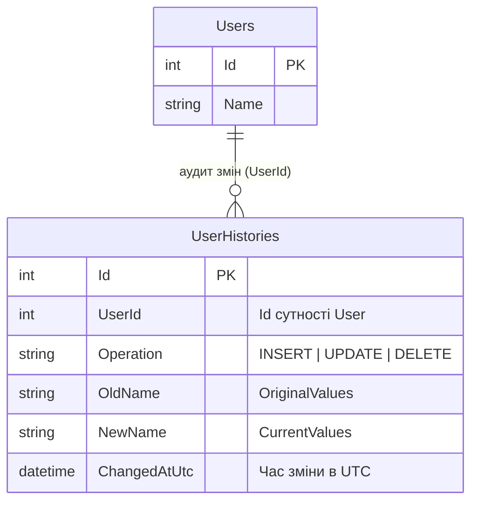

# 8.3. Зберігання історії змін (Temporal Tables / SQLite Audit)

- **Глава:** 08. Додаткові теми
- **Джерело Metanit:** [https://metanit.com/sharp/efcore/8.3.php](https://metanit.com/sharp/efcore/8.3.php)
- **Код прикладу:** [Lesson_8_3_ChangeHistory.cs](../../src/08_AdvancedTopics/Lesson_8_3_ChangeHistory.cs)

---

## Мета уроку

Вивчити механізм **темпоральних таблиць (Temporal Tables)** в Entity Framework Core для MS SQL Server (`IsTemporal()`, методи `TemporalAll`, `TemporalAsOf`, `TemporalFromTo`, `TemporalBetween`, `TemporalContainedIn`), а також реалізувати кросплатформну альтернативу для SQLite на основі **таблиці аудиту** та `SaveChangesInterceptor` для автоматичного логування і відновлення видалених даних.

---

## Детальний теоретичний матеріал

### 1. Темпоральні таблиці у MS SQL Server (`IsTemporal`)

Починаючи з EF Core 6.0, провайдер **MS SQL Server** підтримує системно-версіоновані таблиці (`SYSTEM_VERSIONING = ON`). Це дозволяє серверу БД автоматично зберігати кожну попередню версію рядка при будь-якому `UPDATE` або `DELETE`.

Налаштування у `OnModelCreating`:

```csharp
modelBuilder
    .Entity<User>()
    .ToTable("Users", t => t.IsTemporal());
```

При цьому SQL Server створює основну таблицю з двома прихованими (*shadow*) стовпцями `PeriodStart` і `PeriodEnd` типу `datetime2` та асоційовану таблицю історії `UsersHistory`:

```sql
CREATE TABLE [dbo].[Users] (
    [Id]          INT IDENTITY (1, 1) NOT NULL,
    [Name]        NVARCHAR (MAX) NULL,
    [PeriodEnd]   DATETIME2 (7) GENERATED ALWAYS AS ROW END HIDDEN NOT NULL,
    [PeriodStart] DATETIME2 (7) GENERATED ALWAYS AS ROW START HIDDEN NOT NULL,
    PERIOD FOR SYSTEM_TIME ([PeriodStart], [PeriodEnd])
)
WITH (SYSTEM_VERSIONING = ON (HISTORY_TABLE=[dbo].[UsersHistory], DATA_CONSISTENCY_CHECK=ON));
```

#### Кастомізація таблиці історії та стовпців періоду

```csharp
modelBuilder.Entity<User>().ToTable("Users", t => t.IsTemporal(h =>
{
    h.HasPeriodStart("CreatedAt");
    h.HasPeriodEnd("DeletedAt");
    h.UseHistoryTable("PeopleDataHistory");
}));
```

#### Доступ до тіньових властивостей та методи вибірки історії

Для актуального об'єкта значення тіньових стовпців можна отримати через `ChangeTracker`:

```csharp
var userEntry = db.Entry(user);
var createdAt = userEntry.Property<DateTime>("PeriodStart").CurrentValue;
var deletedAt = userEntry.Property<DateTime>("PeriodEnd").CurrentValue; // для активного рядка це 31.12.9999 23:59:59
```

Для запитів до історії у просторі імен `Microsoft.EntityFrameworkCore` доступні 5 методів розширення для `DbSet<T>`:

| Метод EF Core | Опис |
| :--- | :--- |
| **`TemporalAll()`** | Повертає всі версії рядків за весь час (і актуальні, і з таблиці історії). |
| **`TemporalAsOf(date)`** | Повертає стан даних на конкретний момент часу `date` (по одному рядку на об'єкт). |
| **`TemporalFromTo(start, end)`** | Повертає стани, що існували в інтервалі `start < t < end`. |
| **`TemporalBetween(start, end)`** | Аналогічно `TemporalFromTo`, але включає також рядки, активні точно на момент `end`. |
| **`TemporalContainedIn(start, end)`** | Повертає рядки, які почали й завершили своє існування виключно всередині `[start, end]`. |

Приклад вибірки всієї історії користувача з прихованими стовпцями через `EF.Property<DateTime>`:

```csharp
var history = db.Users.TemporalAll()
    .Where(u => u.Id == 1)
    .OrderBy(e => EF.Property<DateTime>(e, "PeriodStart"))
    .Select(u => new
    {
        User = u,
        Start = EF.Property<DateTime>(u, "PeriodStart"),
        End = EF.Property<DateTime>(u, "PeriodEnd")
    })
    .ToList();
```

#### Відновлення видаленого запису в SQL Server

Після видалення користувача його попередній стан можна дістати через `TemporalAsOf(date)`. Оскільки `Id` уже заданий, перед `Add(user)` і `SaveChanges()` у SQL Server потрібно в межах транзакції тимчасово дозволити явну вставку ідентифікатора:

```csharp
using var transaction = db.Database.BeginTransaction();
db.Database.ExecuteSqlRaw("SET IDENTITY_INSERT [dbo].[Users] ON");
db.Users.Add(user);
db.SaveChanges();
db.Database.ExecuteSqlRaw("SET IDENTITY_INSERT [dbo].[Users] OFF");
transaction.Commit();
```

---

### 2. Альтернатива для SQLite: таблиця аудиту + `SaveChangesInterceptor`

SQLite не має вбудованих темпоральних таблиць (`IsTemporal()`). Для реалізації історії змін у SQLite застосовують два підходи:
1. **SQLite-тригери (`AFTER INSERT / UPDATE / DELETE`):** записують зміни безпосередньо на рівні БД (спрацьовують навіть при сирому SQL чи `ExecuteUpdate`/`ExecuteDelete`).
2. **`SaveChangesInterceptor` + таблиця аудиту (`UserHistories`):** перехоплює збереження змін в EF Core, читає `ChangeTracker` (`Added`, `Modified`, `Deleted`, `OriginalValues`, `CurrentValues`) і зберігає знімки в окрему таблицю. Це повністю типобезпечний, кросплатформний підхід на C#.

---

## Діаграма / Архітектура процесу

ER-діаграма зв'язку основної таблиці `Users` та таблиці аудиту `UserHistories`:



---

## Покроковий розбір прикладів коду

У файлі [Lesson_8_3_ChangeHistory.cs](../../src/08_AdvancedTopics/Lesson_8_3_ChangeHistory.cs) реалізовано повний механізм аудиту в SQLite через `AuditSaveChangesInterceptor`:

1. **Перехоплення до збереження (`SavingChanges`):**
   - Інтерсептор перевіряє прапорець `_isSavingAudit`, щоб не реагувати на власні записи аудиту.
   - Перебирає `eventData.Context.ChangeTracker.Entries<User>()` і формує список `_pendingLogs`:
     - для `EntityState.Added`: `Operation = "INSERT"`, `OldName = null`, `NewName = entry.Entity.Name` (на цьому етапі `UserId` ще дорівнює `0`, бо SQLite ще не згенерував автоінкрементний `Id`);
     - для `EntityState.Modified`: `Operation = "UPDATE"`, `OldName = entry.OriginalValues.GetValue<string?>("Name")`, `NewName = entry.CurrentValues.GetValue<string?>("Name")`;
     - для `EntityState.Deleted`: `Operation = "DELETE"`, `OldName = entry.OriginalValues.GetValue<string?>("Name")`, `NewName = null`.
2. **Запис аудиту після збереження (`SavedChanges`):**
   - Виконується вже **після** того, як БД згенерувала реальний `Id` для нових користувачів.
   - Інтерсептор встановлює `_isSavingAudit = true`, для записів із `UserId == 0` підставляє `entry.Entity.Id`, додає всі `UserHistory` у контекст і викликає `eventData.Context.SaveChanges()`.
   - У блоці `finally` скидає `_isSavingAudit = false`.
3. **Серія операцій у `Run()`:**
   - Послідовно виконуються `INSERT` (`"Tom"`), два `UPDATE` (`"Bob"`, `"Sam"`) та `DELETE`.
   - Запит до `db.UserHistories.Where(h => h.UserId == createdUserId).OrderBy(h => h.Id)` показує всю хронологію (аналог `TemporalAll()`).
4. **Відновлення видаленого запису:**
   - Знаходимо останній запис аудиту з `Operation == "DELETE"`, беремо `UserId` та `OldName` (`"Sam"`), створюємо новий `User { Id = deletedSnapshot.UserId, Name = deletedSnapshot.OldName }` і зберігаємо його в БД.

---

## Особливості роботи в SQLite

| Аспект | MS SQL Server | SQLite |
| :--- | :--- | :--- |
| **Вбудований `IsTemporal()`** | Повністю підтримується (пакет `Microsoft.EntityFrameworkCore.SqlServer`). | **Не підтримується** в SQLite. |
| **Відновлення зі старим `Id`** | Потрібна транзакція та `SET IDENTITY_INSERT [dbo].[Users] ON/OFF`. | Для `INTEGER PRIMARY KEY` не потрібні жодні додаткові команди — достатньо задати `Id = oldId` при `Add(...)`. |
| **Масові операції `ExecuteUpdate` / `ExecuteDelete`** | SQL Server автоматично записує зміни в `UsersHistory` на рівні рушія БД. | `SaveChangesInterceptor` **не спрацьовує** для `ExecuteUpdate`/`ExecuteDelete`, бо вони йдуть в обхід `ChangeTracker`. Для них у SQLite потрібні SQL-тригери. |

---

## Типові помилки, підводні камені та Best Practices

- **Нескінченна рекурсія в `SavedChanges`:** якщо ви викликаєте `context.SaveChanges()` всередині `SavedChanges` для збереження аудиту без запобіжника `_isSavingAudit`, інтерсептор викликатиме сам себе нескінченно до `StackOverflowException`.
- **Потокобезпечність `SaveChangesInterceptor`:** у нашому навчальному прикладі кожен екземпляр `AuditHistoryContext` створює власний `_auditInterceptor`, тому поля `_pendingLogs` і `_isSavingAudit` безпечні. Якщо ви реєструєте один singleton-інтерсептор у DI для багатьох контекстів, зберігайте тимчасовий стан у `AsyncLocal<T>` або `ConditionalWeakTable<DbContext, ...>`.
- **Завжди використовуйте UTC:** для систем аудиту та темпоральних таблиць зберігайте час виключно в `DateTime.UtcNow`, щоб уникнути дублювання чи зсуву годин при переході на літній/зимовий час.
- **Відсутність відстеження для `Temporal*`:** у SQL Server усі методи `TemporalAll()`, `TemporalAsOf()` тощо повертають сутності в режимі `AsNoTracking` — щоб відновити або змінити такий об'єкт, його потрібно явно приєднати через `Add` або `Update`.
